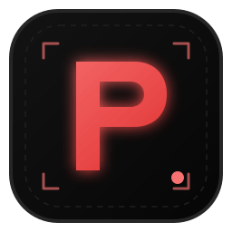

<div align="center">
  
  <h1>OpenProStreet Launcher</h1>
  <p>Unified cross-platform launcher for Need for Speed: ProStreet with <a href="https://code.weexnes.dev/OpenProStreet">OpenProStreet</a> on Windows, Linux and the Steam Deck.</p>
  <p>
    <a href="https://code.weexnes.dev/OpenProStreetClient/OpenProStreetLauncher"></a>
    <a href="#install"></a>
    <a href="#build-from-source"></a>
  </p>
</div>

---

Built with [Avalonia UI](https://avaloniaui.net/) (.NET 9), it provides a native, modern interface and single-file
self-contained executables for both operating systems.

## Features

- **Automated component management:**
  - Validates `nfs.exe` version 1.1 (unpacked No-CD).
  - Installs and updates [Ultimate ASI Loader](https://github.com/ThirteenAG/Ultimate-ASI-Loader), [XNFSPS MultiFix](https://code.weexnes.dev/OpenProStreetClient/XNFSPS-MultiFix), and the [OpenProStreet Client](https://code.weexnes.dev/OpenProStreetClient).
  - Installs controller support: [NFS-XtendedInput](https://github.com/xan1242/NFS-XtendedInput), from OpenProStreet's fork ([xtendedinput](https://code.weexnes.dev/xtendedinput)), which builds it for ProStreet and fixes its startup crash under Proton. It's updated with the client. It's on by default; the "Controller support" row turns it off and on again. Its settings (`scripts/NFS_XtendedInput.ini`) are never replaced.
  - Installs and removes [NFS HD Reflections](https://code.weexnes.dev/NFSHDReflections) (`NFSPSHDReflections.asi`), keeping `scripts/NFSPSHDReflections.ini` intact when toggled off or updated with the client.
  - Installs and removes TexMod texture packs (`.tpf` or `.zip`) into `scripts/OpenProStreetTextures/` so the client swaps them without TexMod.
  - Toggles DXVK (32-bit `d3d9.dll`) on Windows for drawing through Vulkan (leaving non-DXVK `d3d9.dll` files alone).
  - Notifies you when a new OpenProStreet Client or Launcher version is available.
  - Detects and disables conflicting mods (such as `NFSProStreet.FusionFix` and `ProStreetRPC`).
- **Complete in-app configuration:**
  - Visual editor for `scripts/OpenProStreetClient.ini`: server connection (official, custom, or LAN search), physics fixes (no tank slapper, no speed limiter), display options (borderless window, camera vibration, console window), and advanced debugging.
  - Uncaps the frame rate in races through MultiFix's `FramerateUncap` (without it the game limits races to 30 fps). It's on by default and a setting turns it off. Installs whose MultiFix ini had it off get it turned on once.
- **Steam integration:**
  - Adds the game as a non-Steam game, **Need for Speed: ProStreet (OpenProStreet)**, to all local Steam user profiles.
  - Handles `shortcuts.vdf` backups (`*.openprostreet.bak`) automatically.
  - Sets up Proton compatibility and `WINEDLLOVERRIDES="dinput8=n,b"` on Linux.
- **Windows:**
  - Direct execution without requiring Steam.
  - Optional Steam shortcut integration.
  - Elevated permissions (UAC) support when the game is in protected directories like `Program Files`.
- **Linux and Steam Deck:**
  - Proton prefix setup and game installation from DVD ISO images or existing folders.
  - **Uninstall** next to the game folder deletes the launcher's prefix with the game in it, for a clean reinstall from the Install page. It's only offered for a game the launcher installed; a folder you picked yourself is never deleted. The Steam entry stays and is reused.
  - Automatic `nfs.exe` section header fix (`ExeFix`) for smooth Proton execution.
  - Desktop integration: the `install` command registers a desktop shortcut, menu entry and hicolor icons for application launchers (GNOME, KDE, Rofi `drun`).
  - In-place auto-update via CLI (`update` command).

## Install

Download the release binary for your platform from the newest **Build Release Tag** build on
[OneDev](https://code.weexnes.dev/OpenProStreetClient/OpenProStreetLauncher). Both builds are self-contained
(no .NET runtime installation required).

### Windows

1. Download `OpenProStreetLauncher.exe`.
2. Place it in your Need for Speed: ProStreet game directory or anywhere on your PC.
3. Run `OpenProStreetLauncher.exe`. Select your game directory if prompted.
4. Click **Play** to start!

### Linux and Steam Deck

1. Download `OpenProStreetLauncher`.
2. Make it executable and run the installer:

   ```bash
   chmod +x OpenProStreetLauncher
   ./OpenProStreetLauncher install
   ```

3. The launcher is now in your application menu and can be run with `openprostreet-launcher`.

## Usage

### Linux CLI commands

| Command | Description |
| :-- | :-- |
| `install [--system]` | Installs the binary to `~/.local/bin`, the `.desktop` file to `~/.local/share/applications`, and icons to `~/.local/share/icons/hicolor`. Use `--system` (with `sudo`) to install system-wide. |
| `update [--force]` | Self-updates the launcher binary to the latest OneDev release build. |
| `uninstall [--system]` | Removes installed menu entries and the binary. Settings and the game prefix remain intact. |
| `version` / `-v` | Prints the current version. |
| `help` / `-h` | Prints command line usage. |

## Build from source

Prerequisites: [.NET 9.0 SDK](https://dotnet.microsoft.com/download/dotnet/9.0) or newer.

```bash
./build.sh
```

This will:

1. Run all unit and integration tests (`tests/LauncherTests.csproj`).
2. Build and publish a self-contained `linux-x64` executable to `out/release/OpenProStreetLauncher`.
3. Build and publish a self-contained `win-x64` executable to `out/release/OpenProStreetLauncher.exe`.
4. Verify CLI commands and integration.

### Releases

To release a new version:

1. Update `<Version>` in `OpenProStreetLauncher.csproj`.
2. Commit and push to `master`.
3. The OneDev CI pipeline creates the release tag and publishes the release artifacts.

## License

No license has been chosen yet.
